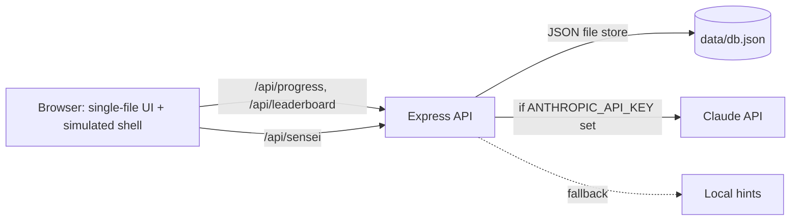

# Debug Dojo

Gamified DevOps debugging dojo: fix broken Linux, Docker, Nginx, Kubernetes and CI setups in a **simulated** Linux terminal (nothing real is executed, so it is safe and light). Includes XP, belts, streaks, badges, a server leaderboard and an AI Sensei.

## Run (one command)
```bash
cp .env.example .env      # optional: add ANTHROPIC_API_KEY for AI Sensei
docker compose up --build
```
Open http://localhost:3000 · health check: http://localhost:3000/health

Without Docker: `cd backend && npm ci && npm start`

## Architecture

- `backend/public/index.html` - frontend (vanilla JS, no build step): welcome page, 7 challenges, mini Linux shell (ls, cd, cat, chmod, grep, pipes, redirects, docker/kubectl/nginx/git simulators).
- `backend/server.js` - API: `/health`, `/api/progress`, `/api/leaderboard`, `/api/sensei`.
- AI Sensei calls Claude server-side, so the key never reaches the browser. It is told not to reveal the exact fix, and falls back to local hints on any error.

## DevSecOps
| Stage | Tool |
|---|---|
| Lint + tests | ESLint, `node --test` |
| Dependency scan | `npm audit`, Dependabot |
| Secret scan | gitleaks |
| SAST | CodeQL |
| Image scan | Trivy (fails on fixable HIGH/CRITICAL) |
| Runtime hardening | non-root user, read-only FS, `cap_drop: ALL`, `no-new-privileges`, Helmet CSP, rate limiting, input validation |

Pipeline: `.github/workflows/ci.yml` (lint, test, scans, build, /health smoke test, push image to GHCR on main). Add your own server step at the end of the `deploy` job.

## Screenshots
Run the app, then save captures to `docs/screenshots/` (welcome page, a challenge, success modal) and reference them here.

## Known limits
Leaderboard is honor-system (no auth). The JSON store suits a small deployment; swap for SQLite/Postgres to scale.
